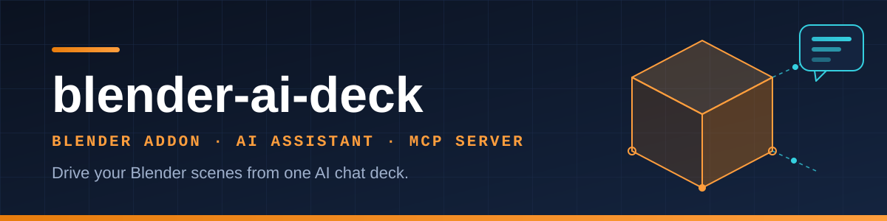

[][download-url]

# blender-ai-deck
**Drive your Blender scenes from one AI chat deck.**

blender-ai-deck turns Blender into a conversational 3D workspace: a built-in AI assistant inspects your scene, creates and edits objects, assigns materials, searches assets and runs multi-step agent workflows — from a visual chat Studio inside Blender and through its own Model Context Protocol (MCP) server for external clients.

[download-url]: https://github.com/snake393/blender-ai-deck/

     

## 🤔 Why

Artists lose hours to repetitive scene chores: placing cameras and lights, arranging product displays, hunting assets, patching together small Python snippets. Asking a chatbot "just do it" usually ends with a script that knows nothing about your scene. blender-ai-deck flips the order — the assistant inspects your scene first, then performs approved, reversible scene operations while you keep working in Blender. The result is faster iteration, fewer repetitive clicks and a clean, supervised path for AI agents into your 3D pipeline.

## ⚖️ Without / With

| Without blender-ai-deck | With blender-ai-deck |
|---|---|
| Menu-diving for every small edit | Describe the change in chat, approve it, done |
| Copy-pasting Python into the text editor and hoping | 21 validated scene tools, from `add_cube` to `export_scene` |
| Switching windows to ask an AI about your scene | Docked Studio workspace with live viewport snapshots |
| One-shot answers with no follow-through | Agent teams: manager, workers and reviewers on a task board |
| Manually browsing asset websites | Search and import from Poly Haven, Sketchfab and Poly Pizza |

## 🏁 Quick Start

1. Grab the release ZIP via [Download][download-url] and save it to your Downloads folder.
2. Unblock the downloaded archive (Windows marks downloaded files) and extract it:
   `powershell Expand-Archive -Path "$env:USERPROFILE\Downloads\blender-ai-deck.zip" -DestinationPath "$env:USERPROFILE\blender-ai-deck" -Force; Get-ChildItem "$env:USERPROFILE\blender-ai-deck" -Recurse | Unblock-File`
3. Start Blender 4.2 or later:
   `powershell Start-Process blender`
   > [!TIP]
   > If `blender` is not on your PATH, start Blender from the Start menu instead.
4. In Blender, open **Edit → Preferences → Get Extensions → ⌄ menu → Install from Disk**, select `blender-ai-deck.zip` and enable the add-on.
5. In the 3D Viewport press **N → AI Deck**, choose a provider (OpenAI, Anthropic Claude, Google Gemini, OpenRouter, OpenCode Zen, Ollama or a custom endpoint), add your connection, pick a model — then send a message or click **Open Studio Window**.

## ✨ Features

- Inspect scenes and objects before every change, so the assistant acts with full context.
- Create and edit geometry through chat — primitives, lights, cameras, duplicates, parenting.
- Assign and tweak materials without opening a single properties panel.
- Run agent teams: a manager splits the brief, workers edit the scene, reviewers approve or return findings.
- Connect any mix of AI providers — OpenAI, Anthropic Claude, Google Gemini, OpenRouter, OpenCode Zen, local Ollama models or custom OpenAI/Anthropic-compatible endpoints.
- Expose your scene to external clients via the built-in authenticated Streamable HTTP MCP server.
- Search and import assets from Poly Haven, Sketchfab and Poly Pizza without leaving Blender.

## ⚙️ How it works

Everything runs locally on your Windows machine. The add-on sits inside Blender and exposes 21 scene tools: inspection (`get_scene_info`, `list_objects`, `get_object_info`), creation (`add_cube`, `add_sphere`, `add_cylinder`, `add_plane`, `add_light`, `add_camera`), editing (`move_object`, `duplicate_object`, `delete_object`, `parent_objects`, `set_material`), visual feedback and scripting (`viewport_screenshot`, `execute_code`), API and export (`bpy_api_lookup`, `describe_node_type`, `export_scene`), plus asset workflows (`search_assets`, `import_asset`). The chat assistant calls these tools step by step — every mutation passes an approval gate and lands as a named undo step, and team-chain tasks run sequentially so scene edits stay ordered. The same toolset is served over an authenticated local Streamable HTTP MCP endpoint, so external clients such as OpenCode can drive Blender too.

## 🧪 Usage

- **Understand a scene before touching it:**
  > Inspect this scene and explain its object structure before making any changes.
- **Set up a product shot in one message:**
  > Create a simple product-display scene with a pedestal, a camera and three lights. Give the pedestal a matte blue material.
- **Build an array and check the result visually:**
  > Duplicate the selected object into a neatly spaced row of five and show the viewport.

> [!NOTE]
> Choose models with tool-calling support. Image-capable models can also interpret viewport screenshots.

## 🔧 Configuration

| Setting | What it controls |
|---|---|
| Provider | Cloud (OpenAI, Claude, Gemini, OpenRouter, OpenCode Zen) or local Ollama / custom endpoint |
| Saved connections | Multiple keys per provider; keep work and personal accounts separate |
| Model | Any tool-calling model; image-capable models add screenshot understanding |
| Asset service keys | Sketchfab / Poly Pizza credentials where required |
| MCP endpoint | Authenticated local Streamable HTTP address for external clients |
| Interface language | English, German, French, Spanish, Chinese |

> [!WARNING]
> Python tool validation helps catch disallowed operations, but it is not a security sandbox. External MCP clients manage their own approval policies — review them before connecting.

## ❓ Troubleshooting / FAQ

**The panel is missing in the sidebar.** Blender 4.2 or later is required; re-check that the add-on is enabled in Preferences → Get Extensions.

**The assistant answers but nothing changes.** Pick a model with tool-calling support — plain chat models cannot call scene tools.

**Screenshots are not interpreted.** Only image-capable models can read viewport snapshots.

**A team task failed review twice.** The workflow stops by design after a second failed review; adjust the instructions and rerun the task.

**Where are my credentials stored?** Connection credentials live in your Blender user settings, chat history lasts for the current session, and the Studio authenticates requests locally.

**Do I need to keep Blender open?** Yes — keep Blender running while you use the Studio window or an external MCP client.

## 🤝 Contributing

Issues and pull requests are welcome — for larger changes, open an issue first and describe the plan. If blender-ai-deck saves you time on real projects, give the repository a star ⭐.

## Keywords

blender · blender-addon · mcp · python · 3d-modeling · llm · model-context-protocol · 3d · blender-mcp · bpy · ai-agents · blender3d · claude-code · mcp-server · addon · ai · blender-extension · blender-python · 3d-automation · 3d-models · blender ai assistant · blender ai · ai for blender · ai blender addon · blender copilot · blender chatgpt · blender claude · blender openai · blender gemini · blender ollama · blender agents · blender multi-agent · blender llm · blender automation · blender scripting · blender plugin · blender workflow · blender api · scene generation · ai modeling · ai materials · 3d workflow · viewport screenshot · mcp integration · opencode blender · ai tools for blender · chat in blender · ai chat blender · multi-agent workflow · ollama · openai · anthropic claude · google gemini · openrouter · asset import · poly haven · sketchfab · 3d assets

## 📄 License

Released under the [MIT](./LICENSE) license.
